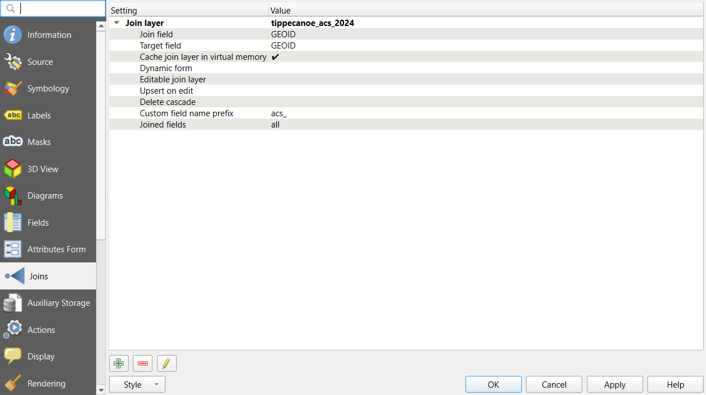
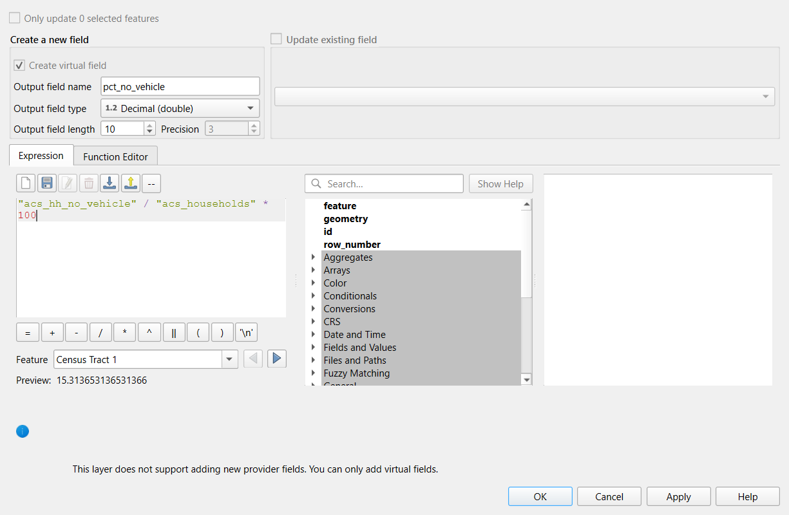

:::::::::::::::::::::::::::::::::::::: questions

- How do I attach a table of statistics to map features in QGIS?
- Why do ID columns cause so many failed joins?
- How do I calculate rates, and what happens with zeros and missing values?
- How do I select and export the features that meet a condition?

::::::::::::::::::::::::::::::::::::::::::::::::

::::::::::::::::::::::::::::::::::::: objectives

- Load a CSV table from the web and inspect field types
- Join a Census table to census tracts with a table join, and check that it worked
- Create rate fields with the Field Calculator and handle division by zero and Census "no estimate" codes
- Select features by expression, summarize them, and export the result

::::::::::::::::::::::::::::::::::::::::::::::::

## Why tables matter

Most social science data arrives as a **table**: a spreadsheet of counts by county, tract or ZIP code, with no
shapes in it. To map it, you attach it to boundaries that share an **ID**. This is the most common task in
applied GIS, and also the most common place for silent mistakes.

This episode uses Tippecanoe County, Indiana (Lafayette and West Lafayette):

| Dataset | File | Contents |
|---|---|---|
| Census tracts (polygons) | `tippecanoe_tracts.geojson` | 43 tracts with `GEOID`, `name` and land area `aland_m2` |
| ACS 2024 table (no shapes) | `tippecanoe_acs_2024.csv` | One row per tract: `GEOID`, `total_pop`, `pop_under18`, `median_income`, `poverty_universe`, `below_poverty`, `households`, `hh_no_vehicle` |

Web addresses to copy:

- **Census tracts (polygons)**: `https://raw.githubusercontent.com/SpatialTurn/Foundations/main/data/tippecanoe_tracts.geojson`
- **ACS 2024 table (no shapes)**: `https://raw.githubusercontent.com/SpatialTurn/Foundations/main/data/tippecanoe_acs_2024.csv`

The table holds 2024 American Community Survey (ACS) 5-year estimates, downloaded once from the Census API for
this lesson. The Data Collection module's [Census episode](https://spatialturn.github.io/DataCollection/census.html)
shows how to request them yourself. The same steps in Python are in Foundations notebooks 3a (tables) and 4c
(joins).

## IDs, types and joins

A **table join** (also called an attribute join) adds the columns of a table to the features of a layer
wherever an ID matches. Census data uses **GEOIDs**, built by concatenating codes:

| Part | Digits | Tippecanoe example |
|---|---|---|
| State | 2 | `18` (Indiana) |
| County | 3 | `157` (Tippecanoe) |
| Tract | 6 | `010400` |
| Tract GEOID | 11 | `18157010400` |

A GEOID looks like a number but is really a **code**, and it should be stored as **text**. Alabama's state code is
`01`, so an Alabama tract GEOID such as `01001020100` loses its leading zero if a program reads it as a number
(`1001020100`), and it will never match the text version in the boundary file. Every field has a **type**
(text, integer, decimal, date), and QGIS shows it next to the field name. Checking types before a join saves
hours.

After every join, check two things:

1. **Did every feature find a match?** Count the features whose joined columns are empty (NULL).
2. **Did any feature match twice?** A table with duplicate IDs can make a join pick an arbitrary row.

## Rates, zeros and missing values

Counts mostly show where many people live. To compare tracts, divide by the right **denominator**:

| Rate | Numerator | Denominator |
|---|---|---|
| Households without a vehicle (%) | `hh_no_vehicle` | `households` |
| Below the poverty line (%) | `below_poverty` | `poverty_universe` (people whose poverty status is known) |
| Children (%) | `pop_under18` | `total_pop` |

Two kinds of trouble appear in real Census tables:

- **Zero denominators.** Census Tract 104 holds Purdue's residence halls: 8,248 people but **0 households** and a
  poverty universe of **0**, because people in group quarters (dorms, prisons, nursing homes) are not
  households and are excluded from poverty counts. Dividing by zero has no answer; QGIS returns **NULL**,
  which is correct, and the tract should be shown as "no data", not as 0%.
- **Special codes.** Where the Census cannot produce an estimate it puts a code instead of a value. Median income
  is **-666666666** for tracts 104 and 105. If you leave it in, any average or map of income is ruined. Replace
  codes with NULL before using the field.

Student populations also explain why tracts near campus show very high poverty rates: students often report
low incomes while being supported by family or loans. That is a real feature of the data, not an error, but it
must be explained in any map of poverty in a college town.

---

## Hands-on

These steps were checked in QGIS 4.0 (QGIS 3.34 and later are nearly identical).

### Part 1: Load the layer and the table

1. Load the tracts web address with **Layer > Add Layer > Add Vector Layer**, **Source Type: Protocol: HTTP(S),
   cloud, etc.**, **Type: HTTP/HTTPS/FTP**, as in the [previous episode](qgisintro.md).
2. Load the ACS table web address the same way. A CSV without coordinates loads as a **table**: it appears in
   the Layers panel with a table icon and draws nothing on the map.

**Check:** 43 tract polygons over Tippecanoe County, and a `tippecanoe_acs_2024` table in the Layers panel.

### Part 2: Look at the table and its field types

1. Right-click `tippecanoe_acs_2024` and choose **Open Attribute Table**. Sort by `total_pop` by clicking its
   header. Find tracts 104 and 105 and look at `households` and `median_income`.
2. Close the table. Right-click the table again, choose **Properties > Fields**. The **Type** column shows
   `GEOID` and `name` as **String** (text) and the counts as **Integer**.
3. Do the same for the tracts layer: its `GEOID` is also **String**. The two ID fields match in type, so the join
   will work.

**Check:** both `GEOID` fields are String, and tract 104 has 0 households.

::::::::::::::::::::::::::::::::::::: callout

### How did QGIS know the types?

A CSV file is plain text and does not store types. This one comes with a small companion file,
`tippecanoe_acs_2024.csvt`, that lists them, and QGIS reads it automatically. Without it, QGIS would read
every column as text when loading from the web, or guess the types when you load a downloaded CSV with
**Layer > Add Layer > Add Delimited Text Layer**. That dialog guesses `GEOID` is a number unless you tell it
otherwise, which is exactly how leading zeros get lost in states whose codes start with 0.

::::::::::::::::::::::::::::::::::::::::::::::::

### Part 3: Join the table to the tracts

1. Right-click the tracts layer, choose **Properties**, then the **Joins** tab.
2. Click the green **+** button at the bottom.
3. **Join layer:** `tippecanoe_acs_2024`. **Join field:** `GEOID`. **Target field:** `GEOID`.
4. Leave **Custom field name prefix** as it is (`tippecanoe_acs_2024_`) or shorten it to `acs_`. This episode
   uses `acs_`.
5. Click **OK**. The join appears in the list; click the arrow next to it to see its settings.

{alt="Screenshot of the QGIS Layer Properties dialog on the Joins tab. One join is listed and expanded: Join layer tippecanoe_acs_2024, Join field GEOID, Target field GEOID, Cache join layer in virtual memory ticked, Custom field name prefix acs_, Joined fields all. The add, remove and edit buttons are at the bottom left."}

6. Click **OK** again to close the Properties.

**Check:** open the tracts' attribute table. New columns such as `acs_total_pop` and `acs_households` appear at
the right, filled in for every row.

To check for unmatched features properly, use an expression:

1. In the tracts' attribute table, click **Select features using an expression** (the icon with an epsilon
   and a yellow square).
2. Enter `"acs_total_pop" IS NULL` and click **Select Features**.

**Check:** the title bar of the table says **0** selected. If it says 43, the join failed completely; look
again at the ID fields and their types.

A table join is **virtual**: the CSV is not copied into the tracts file, and the columns are looked up each
time. Part 6 shows how to save the result as a new file.

### Part 4: Calculate rates with the Field Calculator

The tracts layer came from the web, so it is read-only. We add **virtual fields**: calculated columns stored in
the project rather than in the data file, which suits read-only and joined layers.

1. In the tracts' attribute table, click the **Field Calculator** (the abacus icon).
2. **Create virtual field** is already ticked and grayed out, with a note at the bottom: "This layer does not
   support adding new provider fields. You can only add virtual fields." That is expected for a layer read from
   the web. **Output field name:** `pct_no_vehicle`. **Output field type:** **Decimal (double)**.
3. Expression:

   ```
   "acs_hh_no_vehicle" / "acs_households" * 100
   ```

4. Look at the **Preview** under the expression, then click **OK**.

{alt="Screenshot of the QGIS Field Calculator for the tracts layer. Create virtual field is ticked and grayed out. Output field name is pct_no_vehicle and Output field type is Decimal (double). The expression reads acs_hh_no_vehicle divided by acs_households times 100, and the preview for Census Tract 1 is 15.31. A note at the bottom says the layer does not support adding new provider fields, so only virtual fields can be added."}

**Check:** a new `pct_no_vehicle` column. Sort it: the highest values (above 30%) are tracts 105, 55 and 4, and
tract 104 shows **NULL** because it has no households.

Now clean the income field. Create another virtual field, `income`, type **Integer (32 bit)**, with:

```
if("acs_median_income" < 0, NULL, "acs_median_income")
```

`if(condition, value if true, value if false)` is one of the most useful expressions in QGIS: here, any negative
code becomes NULL and real values pass through.

**Check:** `income` is NULL for tracts 104 and 105, and the lowest real value is about $12,600.

### Part 5: Select by expression and summarize

1. Open **Select features using an expression** again (or **Edit > Select > Select Features by Expression**).
2. Enter `"pct_no_vehicle" >= 10` and click **Select Features**, then **Close**.
3. The selected tracts turn yellow on the map. Right-click the layer and choose **Zoom to Selection** if you
   like.
4. Open **View > Panels > Statistics**, choose the tracts layer and the field `acs_hh_no_vehicle`, and tick
   **Selected features only**.

**Check:** 17 tracts are selected. The Statistics panel shows their total households without a vehicle.

Selecting is different from **filtering**: a selection highlights features but keeps everything in the layer,
while **Filter...** (right-click the layer) hides everything that does not match until you clear it.

### Part 6: Save the joined result

1. Right-click the tracts layer and choose **Export > Save Features As...**
2. **Format:** GeoPackage. **File name:** browse to your project folder and name it `tippecanoe_tracts_acs`.
3. Tick **Save only selected features** if you want just the 17 tracts; leave it unticked for all 43.
4. Click **OK**. The new layer is added to the map.

**Check:** open the new layer's attribute table. The joined `acs_` columns and your virtual fields are now real
columns in the file.

---

:::::::::::::::::::::::::::::::::::: challenge

## Challenge 1: Poverty rate

Create a virtual field `poverty_rate` with the share of people below the poverty line. Which tract has the
highest rate, and which tract cannot have one?

:::::::::::::::: solution

Expression: `"acs_below_poverty" / "acs_poverty_universe" * 100`. The highest is Census Tract 105 (about 80%),
followed by tracts 54.02, 55 and 112, all near Purdue's campus, where many residents are students. Tract 104
has a poverty universe of 0 (residence halls), so its rate is NULL.

:::::::::::::::::::::::::

::::::::::::::::::::::::::::::::::::::::::::::::

:::::::::::::::::::::::::::::::::::: challenge

## Challenge 2: Why did the join fail?

A colleague joins a county table to Alabama county boundaries on `GEOID`. Every joined field is NULL. In the
table, `GEOID` shows values like `1001`; in the boundaries, `01001`. What happened, and how can it be fixed in
QGIS?

:::::::::::::::: solution

The table's `GEOID` was read as a **number**, which dropped the leading zero, so `1001` never matches the text
`01001`. Fixes, from best to quickest:

- Reload the CSV and set the field type to text (in the Delimited Text dialog, **Custom field types**, or with a
  `.csvt` file).
- Or create a text field in the table with the Field Calculator, `lpad(to_string("GEOID"), 5, '0')`, and join on
  it instead.

Then check again for NULLs.

:::::::::::::::::::::::::

::::::::::::::::::::::::::::::::::::::::::::::::

:::::::::::::::::::::::::::::::::::: challenge

## Challenge 3: Count or rate?

You want to show where households without a car are concentrated, to plan a grocery delivery service. Should
the map show `acs_hh_no_vehicle` or `pct_no_vehicle`? Discuss.

:::::::::::::::: solution

It depends on the question. For **planning a service**, the **count** matters: a large tract with 5% carless
households may contain more households to serve than a small tract with 30%. For **comparing need** or
inequality between neighborhoods, the **rate** is fair because it removes the effect of tract size. A good
choropleth uses the rate; counts are better shown with graduated symbols (circles sized by count). Many
reports show both.

:::::::::::::::::::::::::

::::::::::::::::::::::::::::::::::::::::::::::::

::::::::::::::::::::::::::::::::::::: keypoints

- A table join attaches a table to features by a shared ID; check that ID fields have the same type first
- Census GEOIDs are codes: store them as text so leading zeros survive
- After a join, select `"field" IS NULL` to find unmatched features
- Rates need the right denominator; division by zero gives NULL, and Census codes such as -666666666 must be
  replaced with NULL
- Selection highlights features, Filter hides the others, and Save Features As makes joins and virtual fields
  permanent

::::::::::::::::::::::::::::::::::::::::::::::::
