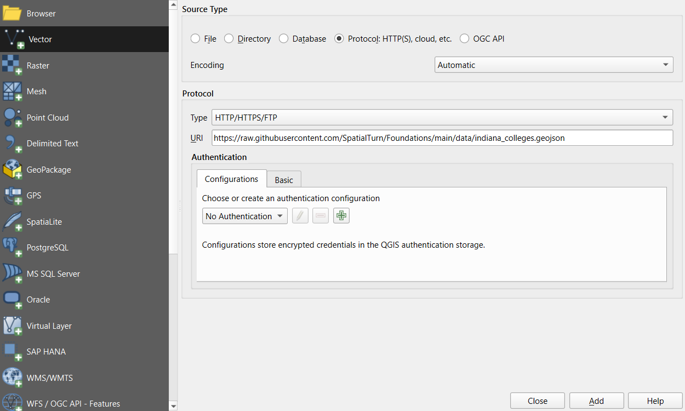
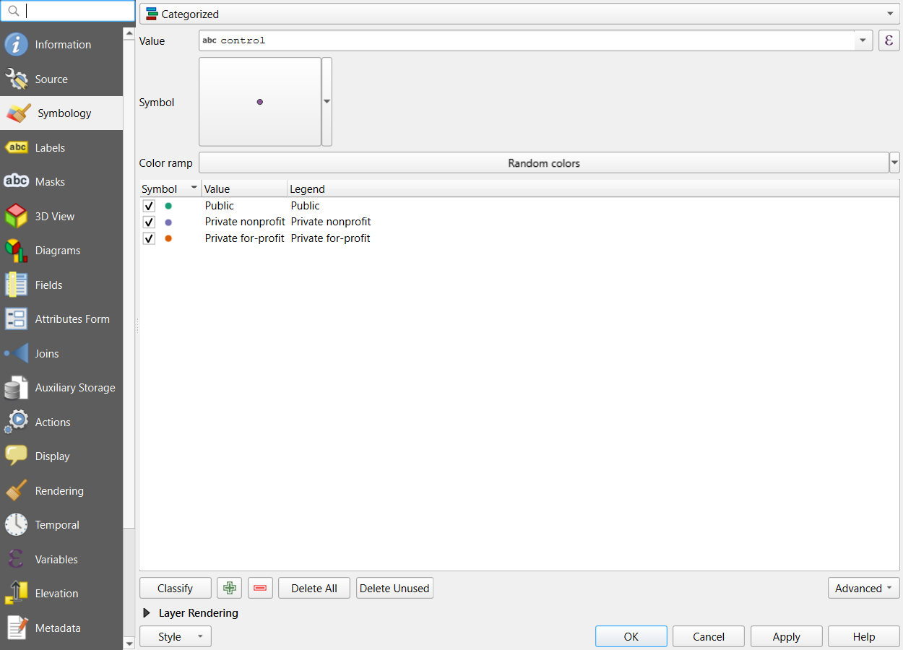
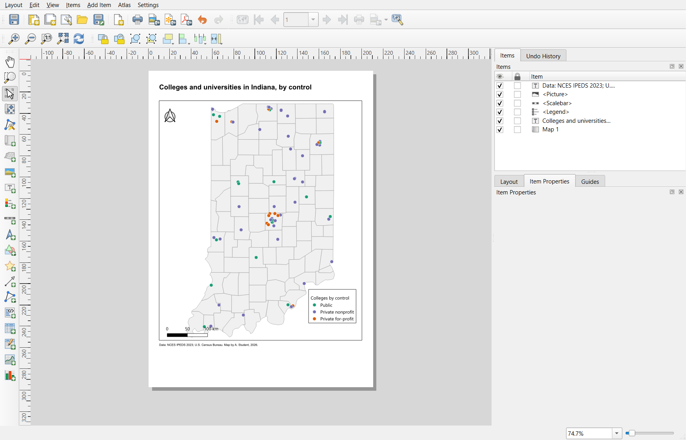
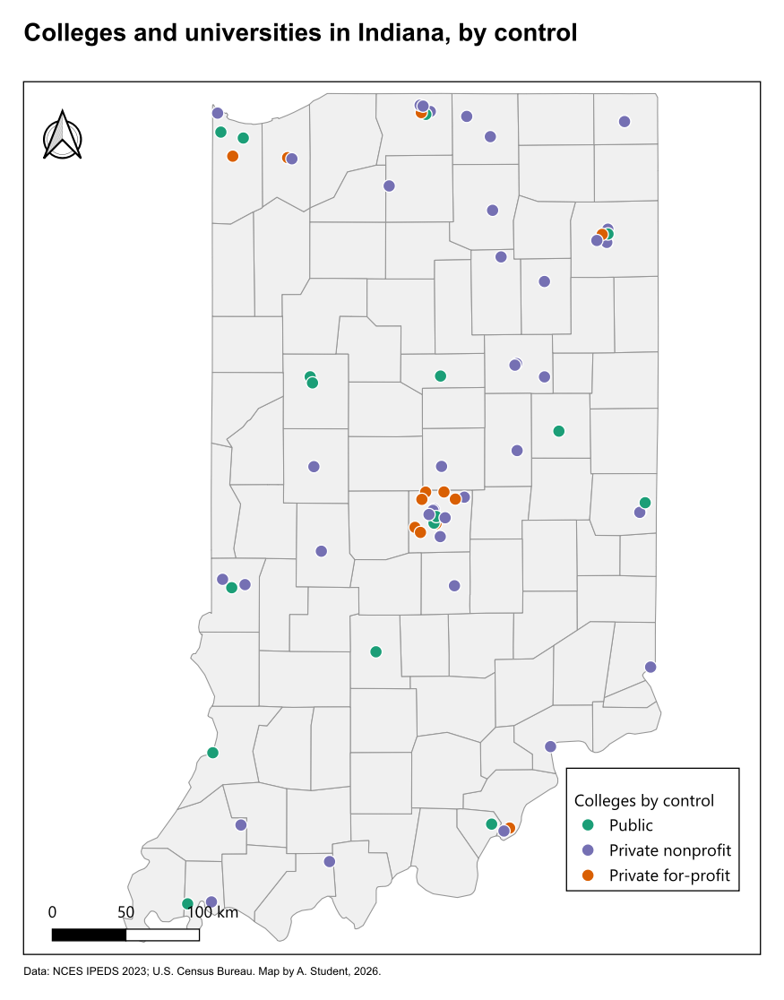

:::::::::::::::::::::::::::::::::::::: questions

- How do I load spatial data into QGIS, including directly from the web?
- How do I explore a layer's attributes?
- How can I style point data by category and polygon data by value?
- How do I create and export a finished map layout?

::::::::::::::::::::::::::::::::::::::::::::::::

::::::::::::::::::::::::::::::::::::: objectives

- Add a basemap and load a vector layer from a web address
- Explore a layer's attribute table
- Style points with categorized symbology
- Build a choropleth map with graduated symbology and compare classification methods
- Create a print layout with title, legend, scale bar, north arrow and source, and export it

::::::::::::::::::::::::::::::::::::::::::::::::

## Before you start

You need QGIS installed. If you have not installed it yet, or the interface is new to you, follow the
[Setup page](../learners/setup.md) first. These steps were checked in **QGIS 4.0**; QGIS 3.34 and later look
almost the same, and differences are noted where they matter.

We will use two small datasets hosted with this lesson. **You do not need to download anything:** QGIS
can read a file directly from its web address.

| Dataset | File | Contents |
|---|---|---|
| Indiana colleges (points) | `indiana_colleges.geojson` | 70 degree-granting colleges and universities with `name`, `city`, `control` (Public, Private nonprofit, Private for-profit) and `level` (4-year or 2-year). From the National Center for Education Statistics (IPEDS, 2023). |
| Indiana counties (polygons) | `indiana_counties.geojson` | 92 counties with `pop_2012`, `land_sq_mi`, `density` (people per square mile) and `unemp_2016` (percent) |

Web addresses to copy:

- **Indiana colleges (points)**: `https://raw.githubusercontent.com/SpatialTurn/Foundations/main/data/indiana_colleges.geojson`
- **Indiana counties (polygons)**: `https://raw.githubusercontent.com/SpatialTurn/Foundations/main/data/indiana_counties.geojson`

Each part below ends with a **Check** line that says what you should see. If your screen does not match, fix
that part before moving on; most problems later come from a step that went wrong earlier.

---

## Part 1: Add a basemap

A basemap gives your data geographic context.

1. In the **Browser** panel (usually on the left), expand **XYZ Tiles**. If you do not see the Browser panel,
   open it with **View > Panels > Browser**.
2. Right-click **OpenStreetMap** and choose **Add Layer to Project**.

**Check:** a world map fills the map canvas, and `OpenStreetMap` is listed in the **Layers** panel.

---

## Part 2: Load a layer from the web

1. Go to **Layer > Add Layer > Add Vector Layer**.
2. Under **Source Type**, choose **Protocol: HTTP(S), cloud, etc.**
3. Set **Type** to **HTTP/HTTPS/FTP**. (In QGIS 4 this list starts with cloud storage services, so check it;
   in QGIS 3 it is already selected.)
4. In **URI**, paste the colleges web address from the list above.
5. Click **Add**, then **Close**.

{alt="Screenshot of the QGIS Data Source Manager on the Vector page. Source Type is set to Protocol: HTTP(S), cloud, etc. Under Protocol, Type is HTTP/HTTPS/FTP and the URI box holds the web address of indiana_colleges.geojson on raw.githubusercontent.com. Authentication is left at No Authentication. The Add button is at the bottom right."}

6. If the points are hidden under the basemap, drag `indiana_colleges` above `OpenStreetMap` in the
   Layers panel. Layers at the top of the list are drawn on top.
7. Right-click the colleges layer and choose **Zoom to Layer**.

**Check:** about 70 points over Indiana, with clusters around Indianapolis, Fort Wayne and the Chicago suburbs
in the northwest.

::::::::::::::::::::::::::::::::::::: callout

### Loading local files

To load a file saved on your computer instead, keep **Source Type** as **File** and browse to it. For a
shapefile, select the `.shp` file; the `.dbf`, `.shx`, `.prj` and `.cpg` files with the same name must
be in the same folder. A zipped shapefile can be added directly, without unzipping.

::::::::::::::::::::::::::::::::::::::::::::::::

Save your project now (**Project > Save**, which creates a `.qgz` file) and save regularly as you work.

---

## Part 3: Explore the attributes

1. Right-click the colleges layer and choose **Open Attribute Table**.
2. Click the `control` column header to sort it.
3. Click the **Identify Features** tool (the "i" icon on the toolbar), then click one point on the map to see
   its attributes in a panel.

**Check:** the table has **70 rows**, one per college, and the columns `name`, `city`, `control`, `level` and
`unitid` (the federal ID). 16 colleges are Public, 42 Private nonprofit and 12 Private for-profit.

The attribute table holds the data behind the map. Every styling choice you make next is based on one of these
columns. Look up Purdue: why might "Purdue University Global", an online university, appear in West Lafayette?
(Its official address is there; locations in a dataset are not always where the activity happens.)

---

## Part 4: Style the points

Color the colleges by who runs them:

1. Right-click the colleges layer and choose **Properties**, then the **Symbology** tab.
2. At the top, change **Single Symbol** to **Categorized**.
3. Set **Value** to `control`.
4. Click **Classify**. Each type gets its own color. (QGIS also adds an empty "all other values" row; you can
   leave it.)
5. Double-click a symbol to change its color or size. Use clearly different colors, and a size of about
   3 millimeters.
6. Click **OK**.

{alt="Screenshot of the QGIS Layer Properties dialog for the colleges layer on the Symbology tab. The renderer at the top is Categorized and Value is control. The list of classes shows three symbols and values: Public in green, Private nonprofit in purple and Private for-profit in orange, each with a matching legend label. Below the list are the Classify, plus, minus, Delete All and Delete Unused buttons, and OK, Cancel, Apply and Help at the bottom."}

**Check:** three colors on the map, and three entries under the layer in the Layers panel.

Each renderer is suited to a type of data:

| Renderer | Use for | Example |
|---|---|---|
| **Single Symbol** | Showing where things are | All colleges in one style |
| **Categorized** | Categories (no order) | College `control` |
| **Graduated** | Numbers (low to high) | County `density` |

To rename the layer, as it will appear in the legend, open **Properties > Source** and change the
**Layer name** (for example, to "Colleges by control"), or right-click it and choose **Rename Layer**.

---

## Part 5: Build a choropleth map

Now load the Indiana counties and shade them by population density.

1. Load the Indiana counties web address the same way as in Part 2.
2. Open **Properties > Symbology** and change **Single Symbol** to **Graduated**.
3. Set **Value** to `density`.
4. Choose a **Color ramp** such as **Blues** or **Viridis**.
5. Set **Mode** to **Natural Breaks (Jenks)** and **Classes** to 5.
6. Click **Classify**, then **Apply** (not OK yet).
7. Change **Mode** to **Equal Interval**, click **Classify** and **Apply**. Then try **Equal Count
   (Quantile)**. Watch how the map changes.

Population density in Indiana is very skewed: most counties have fewer than 200 people per square mile,
and Marion County (Indianapolis) has over 2,000. With Equal Interval, almost every county lands in the
lightest class. Choose the mode that best shows your message, and click **OK**.

**Check:** with Natural Breaks, Marion County is alone in the darkest class.

::::::::::::::::::::::::::::::::::::: callout

### Why density and not population?

The layer also has `pop_2012`, a count. Shading areas by a count mostly shows where big counties or
big cities are. Density (people per square mile) is a rate, so it can be compared fairly between
counties of different sizes. See the Normalization section of the Data Visualization module's
[Fundamentals of Map Design](https://spatialturn.github.io/DataVisualization/mapbasics.html) episode.

::::::::::::::::::::::::::::::::::::::::::::::::

For the layout below, keep the counties as a light, plain background: switch their symbology back to
**Single Symbol** with a pale fill, or untick the choropleth layer and load the counties a second time.
A map with two strong color schemes is hard to read.

---

## Part 6: Create a map layout

To export a finished map with all its elements, use a **Print Layout**.

1. Go to **Project > New Print Layout** and give it a name.
2. **Add the map:** choose **Add Item > Add Map**, then click and drag a rectangle on the page.
3. **Add a title:** choose **Add Item > Add Label**, drag a box above the map, and type your title in the
   **Item Properties** panel. Make it large.
4. **Add a legend:** choose **Add Item > Add Legend** and drag a box. In Item Properties, untick **Auto
   update**, then remove the basemap from the legend with the minus button and rename entries by
   double-clicking them.
5. **Add a scale bar:** choose **Add Item > Add Scale Bar**. Set the units to miles or kilometers.
6. **Add a north arrow:** choose **Add Item > Add North Arrow**.
7. **Add a source line:** add another label at the bottom with the data source and your name, for
   example "Data: NCES IPEDS 2023; U.S. Census Bureau. Basemap: OpenStreetMap contributors. Map by A. Student,
   2026."

Use **Item Properties** to change fonts, sizes and frames. Use the **Move Item Content** tool to pan
the map inside its frame without moving the frame.

{alt="Screenshot of the QGIS Print Layout window. The toolbar on the left has the tools for adding items (map, picture, label, legend, scale bar, north arrow, shapes and more). The A4 page in the middle holds a title, a map of Indiana counties with colleges shown as colored dots, a north arrow at the top left of the map, a legend titled Colleges by control at the lower right, a scale bar from 0 to 100 km at the lower left and a source line under the map. The Items panel on the right lists the six items: the source label, the picture (north arrow), the scale bar, the legend, the title label and Map 1."}

**Check:** the page shows the map, a title, a legend without the basemap, a scale bar, a north arrow and a
source line.

---

## Part 7: Export

1. In the layout window, choose **Layout > Export as Image** (PNG) or **Layout > Export as PDF**.
2. Choose a file name and location and accept the default options.
3. Save the project again (`.qgz`). The layout is saved inside the project.

This example uses a plain county background instead of the basemap, which often reads better on paper.

{alt="A finished QGIS map titled Colleges and universities in Indiana, by control. Indiana's 92 counties are drawn in pale gray with thin outlines, and colleges are colored dots: green for Public, purple for Private nonprofit and orange for Private for-profit. The dots cluster around Indianapolis, Fort Wayne, South Bend and the Chicago suburbs in the northwest. A legend at the lower right lists the three types, a scale bar from 0 to 100 km sits at the lower left, a north arrow at the upper left, and a source line under the map credits NCES IPEDS 2023 and the U.S. Census Bureau."}

---

## Common beginner mistakes

- Forgetting to save the project
- Loading a web address with the wrong protocol **Type** (Part 2): the layer fails to load
- Data loaded but not visible: use **Zoom to Layer** and check the layer order
- Mapping counts instead of rates on a choropleth map
- Leaving layer names such as `indiana_counties` in the legend
- Using too many classes or a rainbow color ramp
- Leaving out the source line, legend or title

::::::::::::::::::::::::::::::::::::: callout

### Keep it simple

Start with a clear, simple map. Add complexity only when it helps the reader.

::::::::::::::::::::::::::::::::::::::::::::::::

---

## Hands-on exercise

:::::::::::::::::::::::::::::::::::: challenge

## Challenge 1: An unemployment map of Indiana

Using the Indiana counties layer, create and export a finished map of **2016 unemployment rates**
(`unemp_2016`).

1. Use **Graduated** symbology with 5 classes and a sequential color ramp.
2. Try two classification modes and pick the one that shows the pattern best.
3. Build a layout with a title that states what the map shows, a legend with units (%), a scale bar,
   a north arrow and a source line.
4. Export it as a PNG.

:::::::::::::::::::::::::::::::::: solution

- **Value:** `unemp_2016`. **Color ramp:** a single hue such as Oranges or Blues (light for low, dark
  for high).
- **Mode:** unemployment ranges only from about 3.1% to 6.6% and is not very skewed, so **Natural
  Breaks** or **Equal Interval** both give readable maps. Quantile also works if the message is about
  rankings.
- **Legend:** rename the layer to something like "Unemployment rate, 2016 (%)".
- **Title:** for example, "Unemployment was highest in northwestern and southern Indiana in 2016". Check
  your own map before writing a conclusion like this.
- **Source:** "Data: U.S. Bureau of Labor Statistics, 2016."

::::::::::::::::::::::::::::::::::::
::::::::::::::::::::::::::::::::::::::::::::::::

:::::::::::::::::::::::::::::::::::: challenge

## Challenge 2: Show and label only public universities (optional)

Make the colleges layer show only **public 4-year** institutions, and label them with their names.

:::::::::::::::::::::::::::::::::: solution

1. Right-click the colleges layer and choose **Filter...**. Enter the expression
   `"control" = 'Public' AND "level" = '4-year or above'` and click **OK**. The layer now shows only those
   features (the filter icon appears next to its name), and the attribute table lists only them.
2. Open **Properties > Labels**, choose **Single Labels**, set **Value** to `name`, and click **OK**.
3. To show everything again, open **Filter...** and clear the expression.

Field names go in double quotes and text values in single quotes; mixing them up is the most common
expression error.

::::::::::::::::::::::::::::::::::::
::::::::::::::::::::::::::::::::::::::::::::::::

::::::::::::::::::::::::::::::::::::: callout

### Layer CRS and project CRS

Every layer has its own coordinate reference system (CRS), shown under **Layer Properties >
Information**. The **project** also has a CRS, shown in the bottom-right corner of the window. QGIS
reprojects layers on the fly so that they line up on screen, which is convenient but can hide a layer
with a wrong or missing CRS. Two habits avoid most problems:

- Before measuring distances or areas, set the project CRS (and reproject layers you will analyze) to a
  projected system in meters, such as **EPSG:26916** (UTM zone 16N) for Indiana.
- If a layer appears in the wrong place, check its CRS before anything else.

Try it: click the EPSG code in the bottom-right corner, search for **26916**, and click **OK**. Indiana looks
slightly narrower and less stretched than on the Web Mercator basemap. Notebook 4b in this module shows the
same ideas in Python, and the Data Management module's
[Coordinate Reference Systems](https://spatialturn.github.io/DataManagement/crs.html) episode explains
the theory.

::::::::::::::::::::::::::::::::::::::::::::::::

---

## Final takeaways

- QGIS is a free, powerful tool for designing maps.
- Layers can be loaded from files on your computer or directly from a web address.
- Categorized symbology suits categories; graduated symbology suits numbers.
- The print layout is where map elements (title, legend, scale bar, north arrow, source) come together.

::::::::::::::::::::::::::::::::::::: discussion

- What challenges did you face while making your first map?
- How would you change your map for a different audience?

::::::::::::::::::::::::::::::::::::::::::::::::

::::::::::::::::::::::::::::::::::::: keypoints

- Add Vector Layer with the HTTP(S) protocol (Type HTTP/HTTPS/FTP) loads data straight from a web address.
- Use the Check lines: Zoom to Layer and layer order solve most "missing data" problems.
- The attribute table holds the data behind every styling choice.
- Use Categorized for categories and Graduated for numbers, and compare classification modes.
- A Print Layout combines the map with its title, legend, scale bar, north arrow and source.
- Save the project often; export layouts as PNG or PDF.
- Check layer and project coordinate systems before measuring anything.

::::::::::::::::::::::::::::::::::::::::::::::::
